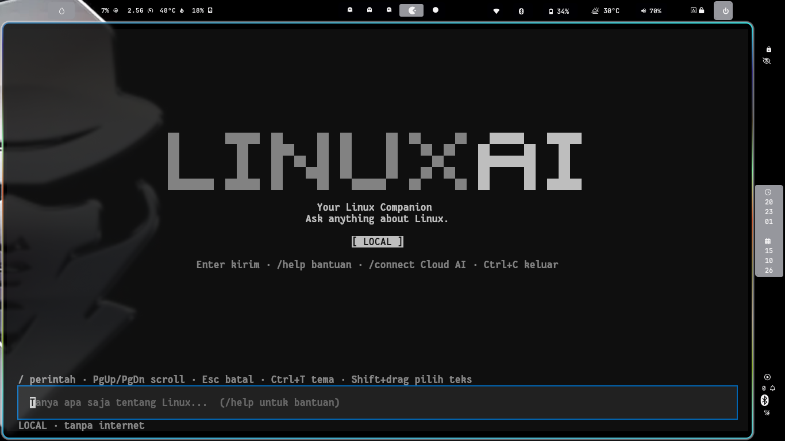
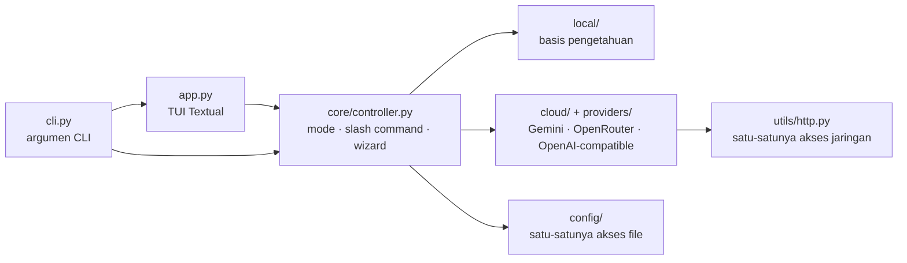

<div align="center">

```
█    ███ █   █ █   █ █   █  ███  ███
█     █  ██  █ █   █  █ █  █   █  █
█     █  █ █ █ █   █   █   █████  █
█     █  █  ██ █   █  █ █  █   █  █
████ ███ █   █  ███  █   █ █   █ ███
```

# LinuxAI — *Your Linux Companion*

**Chatbot terminal untuk pengguna Windows yang baru pindah ke Linux.**
Tanya soal perintah, error, atau cara kerja Linux — langsung dari terminal, dalam bahasa Indonesia.


</div>

---

## ✨ Kenapa LinuxAI?

Pindah dari Windows ke Linux itu seru, tapi banyak hal yang tiba-tiba terasa asing: tidak ada `C:\`, tidak ada `.exe`,
dan pesan seperti `permission denied` atau `command not found` muncul tanpa penjelasan.
LinuxAI hadir sebagai teman belajar yang selalu ada di terminalmu.

- 🐧 **Dibuat khusus untuk pemula Linux.** Jawaban memakai bahasa sederhana, menjelaskan *fungsi* dan *risiko* sebuah perintah sebelum menyarankannya.
- 🔌 **Bisa dipakai langsung, tanpa akun.** Local Mode jalan tanpa API key, tanpa internet, tanpa unduh model besar.
- ☁️ **Opsional: bawa AI-mu sendiri.** Hubungkan Google Gemini, OpenRouter, atau provider kompatibel OpenAI dengan API key milikmu.
- 🖥️ **Antarmuka layar penuh ala agent CLI modern.** Logo besar, menu saran saat mengetik `/`, dialog pop-up, dan teks berwarna.
- 🔒 **Aman karena dirancang tidak bisa berbuat macam-macam.** Hanya menampilkan teks. Tidak menjalankan perintah, tidak menyentuh file-mu.

## 🖼️ Tampilan

<div align="center">

</div>

## 🚀 Mulai cepat

Butuh **Python 3.10+** (sudah ada di Linux Mint 21+ dan Ubuntu 22.04+).

```bash
git clone https://github.com/Gna68/LINUX-AI.git
cd LINUX-AI

sudo apt update
sudo apt install python3 python3-venv pipx
pipx ensurepath            # lalu tutup dan buka terminal baru
pipx install .

linuxai
```

<details>
<summary>Tanpa pipx (virtual environment)</summary>

```bash
cd LINUX-AI
python3 -m venv .venv
source .venv/bin/activate
pip install -e .
linuxai
```

</details>

## 💬 Cara pakai

```bash
linuxai                              # buka TUI layar penuh
linuxai "apa itu sudo"               # satu pertanyaan (Local Mode)
linuxai --local "wifi tidak muncul"  # paksa Local Mode
linuxai --cloud "jelaskan error ini" # pakai provider cloud yang sudah tersimpan
linuxai --help
linuxai --version
```

Tanpa `--cloud`, pertanyaanmu **tidak pernah** dikirim ke internet.

### Contoh pertanyaan untuk Local Mode

`apa beda Windows dan Linux` · `cara install aplikasi` · `apa fungsi perintah grep` · `permission denied` ·
`wifi tidak muncul` · `cara dual boot` · `pengganti Photoshop` · `Could not get lock /var/lib/dpkg/lock` ·
`externally-managed-environment` · `flashdisk NTFS read-only`

### Slash command

Ketik `/` dan menu saran langsung muncul. `↑` `↓` memilih · **Enter** menjalankan · **Tab** melengkapi · **Esc** menutup.

| Perintah | Fungsi |
|---|---|
| `/connect` | Hubungkan provider AI lewat dialog pop-up (provider → API key → model) |
| `/provider` | Lihat atau ganti provider |
| `/model` | Lihat atau ganti model |
| `/mode` | Pindah Local ⇄ Cloud (`/mode local`, `/mode cloud`) |
| `/settings` | Ringkasan pengaturan, hapus API key (`delete-key`, `delete-all`) |
| `/copy` | Salin jawaban terakhir ke clipboard |
| `/clear` | Bersihkan percakapan |
| `/help` | Bantuan |
| `/exit` | Keluar |

### Keyboard

| Tombol | Fungsi |
|---|---|
| `Enter` | Kirim pesan |
| `PgUp` / `PgDn` | Scroll percakapan |
| `Esc` | Tutup menu / batalkan dialog |
| `Ctrl+L` | Bersihkan percakapan |
| `Ctrl+T` | Ganti tema gelap / terang |
| `Ctrl+C` | Salin teks terpilih; jika tidak ada, keluar |
| `Shift` + seret mouse | Pilih teks lewat terminal, lalu `Ctrl+Shift+C` |

## 🧠 Dua mode

| | **Local Mode** (default) | **Cloud Mode** (opsional) |
|---|---|---|
| Butuh API key | ❌ | ✅ milikmu sendiri |
| Butuh internet | ❌ | ✅ |
| Cara kerja | Basis pengetahuan bawaan + aturan kata kunci | Model AI dari provider pilihanmu |
| Kemampuan | Topik yang sudah tercakup; sisanya dijawab jujur "belum tahu" | Pertanyaan bebas, analisis output terminal |
| Data keluar dari komputer | Tidak ada | Percakapan sesi cloud dikirim ke provider |

> Local Mode **bukan** LLM dan tidak berpura-pura menjadi LLM.

### Menghubungkan Cloud AI

1. Ketik `/connect`.
2. Pilih provider (bisa dicari) → tempel API key (tersembunyi) → pilih model dari daftar yang diambil langsung dari provider.
3. Pilih apakah mau mengirim tes koneksi, dan apakah konfigurasi disimpan.

| Provider | Catatan |
|---|---|
| Google Gemini API | Daftar model difilter ke yang mendukung chat |
| OpenRouter | Ratusan model lewat satu API key |
| Kompatibel OpenAI | Masukkan base URL sendiri (`https://`, atau `http://localhost` untuk server lokal) |

Kuota dan harga ditentukan provider dan bisa berubah. Jangan menganggap semuanya gratis.
Detail: [docs/providers.md](docs/providers.md).

## 🛡️ Keamanan dan privasi

LinuxAI **hanya chatbot teks**. Batasan ini ditegakkan oleh arsitektur, bukan sekadar permintaan di prompt:

- ❌ Tidak ada eksekusi shell/script, `subprocess`, `os.system`, `eval`/`exec`.
- ❌ Tidak ada tool/function calling, MCP, atau plugin. Permintaan tool dari model diabaikan.
- ❌ Tidak membaca, menulis, atau menghapus file-mu (kecuali berkas konfigurasinya sendiri).
- ✅ Pemindai AST (`python -m linuxai.safety.scanner`) memeriksa seluruh kode dan dijalankan oleh tes otomatis.
- ✅ Teks dari model dibersihkan dari escape sequence terminal sebelum ditampilkan.

**API key:**

- Disimpan **hanya jika kamu setuju**, di `~/.config/linuxai/config.json` (folder `0700`, file `0600`).
- Disimpan sebagai **teks biasa, tidak terenkripsi**. Pilih "Hanya untuk sesi ini" jika tidak mau key ada di disk.
- Tidak pernah ditampilkan ulang, tidak masuk log (aplikasi tidak membuat log), dan hanya dikirim ke provider pilihanmu.
- Redirect HTTP ditolak agar key tidak bocor ke host lain.
- Hapus kapan saja: `/settings delete-key` atau `/settings delete-all`.

**Privasi:** riwayat chat hanya di memori. Pesan yang kamu tulis saat Local Mode tidak pernah ikut terkirim ke provider.
Jangan menempelkan password atau data sensitif ke chat cloud. Selengkapnya: [docs/security.md](docs/security.md).

## 🏗️ Arsitektur



```
linuxai/
├── cli.py            # entry point & argumen CLI
├── app.py            # TUI layar penuh (Textual)
├── core/             # otak aplikasi: mode, slash command, wizard /connect
├── local/            # Local Mode: basis pengetahuan + pencocok
├── cloud/            # antarmuka provider + klien
├── providers/        # Gemini, OpenRouter, OpenAI-compatible
├── config/           # penyimpanan konfigurasi, validasi, penyamaran key
├── prompts/          # system prompt terpusat
├── safety/           # pemindai batasan & pembersih teks
├── ui/               # logo, pewarnaan, dialog pop-up, CSS
└── utils/            # klien HTTP
tests/                # 117 tes otomatis (mock; tanpa internet/kuota)
docs/                 # instalasi, penggunaan, provider, keamanan, troubleshooting
```

Penjelasan tiap file ada di [docs/](docs/).

## 🧪 Pengujian

```bash
pip install -e ".[dev]"
pytest                                    # atau: python -m unittest discover -s tests -t .
python -m linuxai.safety.scanner          # periksa batasan "hanya chatbot"
```

Semua tes memakai mock: tidak ada permintaan API sungguhan dan tidak memakai kuota.

## 📌 Status

Proyek ini masih **prototipe**.

- ✅ Local Mode, TUI, dialog `/connect`, penyimpanan konfigurasi, dan batasan keamanan diuji otomatis.
- ✅ Cloud Mode via OpenRouter sudah dicoba manual.
- ⚠️ Gemini dan provider kompatibel OpenAI baru dites lewat mock; belum diverifikasi ke layanan asli. Laporkan jika ada ketidakcocokan.
- ⚠️ Respons cloud tampil utuh setelah selesai (belum streaming).

## 🗺️ Ide pengembangan

- Streaming respons
- Dialog pop-up untuk `/provider` dan `/model`
- Perluas basis pengetahuan Local Mode (lebih banyak distro dan topik)
- Penyimpanan API key terenkripsi (keyring sistem)
- Analisis screenshot error

## 🤝 Berkontribusi

Proyek ini dibuat oleh [Ghana (@Gna68)](https://github.com/Gna68). Kontribusi sangat diterima. Cara termudah: **tambah topik** di `linuxai/local/knowledge.py` (lengkap dengan tes),
atau tambah provider baru di `linuxai/providers/` (lihat [docs/providers.md](docs/providers.md)).
Pastikan `pytest` dan pemindai keamanan lulus sebelum membuat pull request.

## 🗑️ Uninstall

```bash
pipx uninstall linuxai
rm -rf ~/.config/linuxai     # hapus konfigurasi/API key (opsional)
```

## 📄 Lisensi

[MIT](LICENSE) © 2026 Muhammad Ghana Rizqi Pratama.
Kamu bebas memakai dan memodifikasi proyek ini, selama pemberitahuan hak cipta dan lisensi tetap disertakan.

---

<div align="center">

Dibuat oleh **Muhammad Ghana Rizqi Pratama** ([@Gna68](https://github.com/Gna68)) — Ghana.<br>
Untuk semua yang baru belajar Linux. 🐧 Selamat bereksplorasi!

</div>
